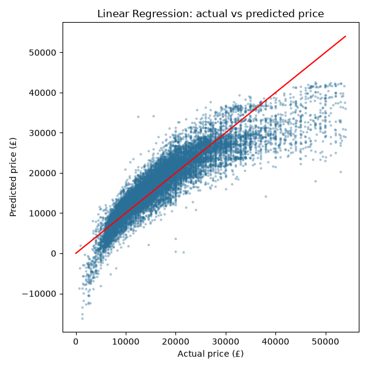

# Used Car Price Estimator

Predicts the price of a used car from its brand, model, age, mileage, fuel type and transmission, using machine learning on about 85,000 UK listings. 

## Dataset

[100,000 UK Used Car Data Set](https://www.kaggle.com/datasets/adityadesai13/used-car-dataset-ford-and-mercedes) from Kaggle: one CSV file per brand, with prices in pounds (£) and mileage in miles.

Columns used: `model`, `year`, `price` (the target), `transmission`, `mileage`, `fuelType`. The files have no brand column, so `brand` is added from the file name.

## Method

**Preprocessing** (`src/data_loader.py`, `src/train.py`)
- Merge the brand files into one table and add a `brand` column.
- Remove rows with missing values and duplicate listings.
- Keep only manufacturing years between 1995 and 2020 (2020 is when the listings were collected).
- Remove the most expensive 1% of cars (outliers).
- Create `age` = 2020 − `year`.
- Convert the text columns (`brand`, `model`, `fuelType`, `transmission`) to numbers with one-hot encoding.

**Evaluation**
- 80/20 train/test split (66,741 training rows, 16,686 test rows).
- Metrics on the test set: MAE, RMSE and R².
- Preprocessing and model are combined in a scikit-learn `Pipeline`, so new data is transformed exactly like the training data.

## Exploratory analysis

`src/data_analyzer.py` prints summary statistics and saves four plots in `plots/`:

## Results: Linear Regression baseline

| Model | MAE | RMSE | R² |
|---|---|---|---|
| Linear Regression | 2,745 £ | 3,947 £ | 0.799 |

On average, the estimate is off by about 2,700 £, and the model explains about 80% of the price differences between cars.



The plot shows where a linear model falls short. The points follow a curve instead of the red line, because cars lose value faster when they are new:
- cheap, older cars get some predictions below zero (down to about −16,000 £);
- cars above roughly 30,000 £ are underestimated.

## How to run

```bash
docker compose up -d
docker compose exec app python src/data_analyzer.py
docker compose exec app python src/train.py
docker compose down
```

## Limitations

- The data comes from the UK, from around 2020, with prices in pounds, so it does not reflect today's market elsewhere.
